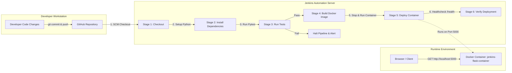

# Automated CI/CD Pipeline for Containerized Applications

> **DevOps Case Study & Practical Demonstration**  
> **Technologies:** GitHub &bull; Jenkins &bull; Docker &bull; Python Flask &bull; Pytest  
> **Target Environment:** Local Windows Workstation (Zero Cloud / No AWS / No Kubernetes)

---

## 1. Project Overview & Objectives

In modern software engineering, manual testing, building, and deploying applications is error-prone, slow, and inconsistent across different machines ("it works on my machine" syndrome). 

This project demonstrates a production-grade, local **Continuous Integration & Continuous Delivery (CI/CD)** pipeline that automates the entire software delivery lifecycle:
1. **Source Code Management (SCM):** Version control and code collaboration using **GitHub**.
2. **Continuous Integration (CI):** Automated dependency installation and unit testing with **Jenkins** and **Pytest**.
3. **Containerization:** Packaging the application into a standard, reproducible image using **Docker**.
4. **Continuous Delivery (CD):** Automatically building, deploying, and verifying the containerized web application on `localhost:5000`.

---

## 2. Architecture & Pipeline Workflow



### End-to-End Execution Sequence
1. **Commit & Push:** Developer pushes code changes to GitHub `main` branch.
2. **Trigger Build:** Jenkins pulls the latest code using SCM Checkout.
3. **Dependency Installation:** Pip installs dependencies from `requirements.txt`.
4. **Automated Testing:** Pytest executes test cases against homepage and `/health`. If any test fails, the pipeline aborts immediately, preventing faulty code from reaching deployment.
5. **Image Build:** Docker builds a minimal image tagged `jenkins-flask-app:latest`.
6. **Container Redeployment:** The pipeline cleanly removes any older container of the same name and runs the new image on port 5000.
7. **Automated Verification:** Jenkins queries `http://localhost:5000/health` via `curl` to ensure the application is responding with HTTP 200 and healthy JSON.

---

## 3. Technology Stack & Justification

| Tool / Technology | Role in Project | Technical Justification |
| :--- | :--- | :--- |
| **Python 3.12 + Flask** | Web Application | Lightweight, readable micro-framework ideal for transparent demonstration of HTTP routes, JSON APIs, and versioning. |
| **Pytest** | Automated Testing | Industry-standard Python testing tool. Provides clear assertions, fixture management, and fast execution without complex setup. |
| **Docker** | Containerization | Ensures environment parity. Eliminates dependency mismatches by bundling Python runtime, packages, and code into an immutable image. |
| **Jenkins** | CI/CD Automation Engine | Open-source, industry-standard orchestration server capable of executing multi-stage declarative pipelines on Windows or Linux. |
| **Git & GitHub** | Source Control Management | Distributed version control providing commit history, branching, and a centralized remote for triggering builds. |

---

## 4. Project Directory Structure

```
jenkins-docker-demo/
├── app.py              # Flask web application with homepage & /health endpoint
├── requirements.txt    # Pinned production and test dependencies
├── test_app.py         # Automated Pytest test suite for route validation
├── Dockerfile          # Production-ready multi-stage Python container build recipe
├── .dockerignore       # Prevents caches, virtual environments & Git files from polluting image
├── .gitignore          # Excludes temporary bytecode, test caches, and logs from Git
├── Jenkinsfile         # Declarative CI/CD pipeline script (Windows & Linux compatible)
└── README.md           # Complete engineering guide, demonstration script, and viva preparation
```

---

## 5. Prerequisites & Environment Verification

Before running the pipeline, ensure the following components are installed and operational on your Windows computer:

### 1. Python & Pip
Check that Python 3.10+ is accessible:
```powershell
python --version
pip --version
```

### 2. Docker Desktop (Crucial Step)
Docker Desktop must be running with its Linux engine active:
1. Open the Windows Start Menu, search for **Docker Desktop**, and launch it.
2. Wait until the Docker icon in the system tray turns steady (Engine running).
3. Test connectivity in PowerShell:
   ```powershell
   docker ps
   ```
   *If you see container headers without error, Docker is ready.*

### 3. Jenkins Server
Jenkins is running natively as a service on `http://localhost:8080`.
- Verify by opening `http://localhost:8080` in your web browser.
- Log in with your admin credentials.

---

## 6. Local Setup & Manual Verification

Run and test the application manually before integrating with Jenkins to confirm all application components work as expected:

### Step 1: Install Dependencies & Run Tests
Open PowerShell inside the `jenkins-docker-demo` directory:
```powershell
cd "c:\Users\Shivam Bhosle\Desktop\DEVOPS\DevOps_IA\jenkins-docker-demo"

# Install pinned dependencies
python -m pip install -r requirements.txt

# Run automated tests
python -m pytest test_app.py -v
```
*Expected result:* 3 tests passing (Homepage status, success message, health endpoint).

### Step 2: Run Application Locally
```powershell
python app.py
```
- Open `http://localhost:5000` in your browser.
- Open `http://localhost:5000/health` to inspect JSON response:
  ```json
  {"service": "jenkins-docker-demo", "status": "healthy", "version": "1.0"}
  ```
- Stop the application with `Ctrl + C`.

---

## 7. Manual Docker Build & Run

Test the container lifecycle manually:

### 1. Build the Docker Image
```powershell
docker build -t jenkins-flask-app:latest .
```

### 2. Run the Container
```powershell
docker run -d --name jenkins-flask-container -p 5000:5000 jenkins-flask-app:latest
```

### 3. Verify Container State
```powershell
docker ps -f name=jenkins-flask-container
curl.exe http://localhost:5000/health
```

### 4. Clean Up Container
```powershell
docker stop jenkins-flask-container
docker rm jenkins-flask-container
```

---

## 8. GitHub Integration

Follow these steps to connect your local repository to GitHub:

### Step 1: Initialize and Commit Locally
```powershell
cd "c:\Users\Shivam Bhosle\Desktop\DEVOPS\DevOps_IA\jenkins-docker-demo"

# Check status
git status

# Add all files to staging
git add .

# Create initial commit
git commit -m "feat: initial commit with Flask app v1.0, pytest, Dockerfile, and Jenkinsfile"
```

### Step 2: Create a New GitHub Repository
1. Log in to your GitHub account at [https://github.com](https://github.com).
2. Click **New Repository**.
3. Name it: `jenkins-docker-demo`.
4. Choose **Public** (or Private).
5. **Do not** initialize with README, .gitignore, or license (these already exist locally).
6. Click **Create repository**.

### Step 3: Connect Remote & Push
Replace `YOUR_GITHUB_USERNAME` with your actual GitHub username:
```powershell
# Set main branch
git branch -M main

# Add remote origin
git remote add origin https://github.com/YOUR_GITHUB_USERNAME/jenkins-docker-demo.git

# Push code to GitHub
git push -u origin main
```

---

## 9. Jenkins Pipeline Setup & Configuration

Configure the Jenkins automated pipeline to execute upon code changes:

### Step 1: Create Pipeline Job in Jenkins
1. Open `http://localhost:8080` in your browser and log in.
2. In the Jenkins Dashboard, click **New Item** (left sidebar).
3. Enter Item Name: `jenkins-docker-pipeline`.
4. Select **Pipeline** as the item type.
5. Click **OK**.

### Step 2: Configure Job Details
1. Scroll down to the **Pipeline** section at the bottom.
2. Under **Definition**, select: **Pipeline script from SCM**.
3. Under **SCM**, select: **Git**.
4. In **Repository URL**, paste your GitHub repository URL:
   `https://github.com/YOUR_GITHUB_USERNAME/jenkins-docker-demo.git`
   *(If your repository is public, no credentials are required. If private, add your GitHub Username/Personal Access Token under Credentials).*
5. Under **Branches to build**, ensure Branch Specifier is set to:
   `*/main`
6. Under **Script Path**, ensure it is:
   `Jenkinsfile`
7. Click **Save**.

### Step 3: Trigger First Pipeline Build
1. Click **Build Now** on the left menu.
2. Watch the **Stage View** as Jenkins executes:
   - `Checkout` &rarr; `Install Dependencies` &rarr; `Run Tests` &rarr; `Build Docker Image` &rarr; `Deploy Container` &rarr; `Verify Deployment`.
3. Click on the build number (e.g., `#1`) &rarr; **Console Output** to view logs.
4. Open `http://localhost:5000` in your browser to see Version 1.0 live!

---

## 10. Live Demonstration Procedure (Version 1.0 &rarr; Version 1.1)

Follow this demonstration during your practical lab or viva examination to prove genuine end-to-end automation:

| Step | Action | Command / Location | Expected Observation |
| :---: | :--- | :--- | :--- |
| **1** | Trigger Initial Build | Jenkins UI: `Build Now` | All 6 stages turn GREEN. App runs on `http://localhost:5000` showing **v1.0**. |
| **2** | Modify Application Code | Open `app.py`, change `APP_VERSION = "1.0"` to `"1.1"` | Local code is updated. |
| **3** | Commit & Push to GitHub | `git commit -am "chore: bump version to 1.1"`<br>`git push origin main` | GitHub repository reflects the latest commit. |
| **4** | Trigger Pipeline Build | Jenkins UI: `Build Now` | Jenkins executes Build `#2`. It stops old container, builds updated image, and deploys. |
| **5** | Verify Deployment | Refresh browser on `http://localhost:5000` | Browser dynamically reflects **v1.1** without manual container recreation. |
| **6** | Verify Failure Handling | Break a test in `test_app.py` (e.g. change expected message), commit, push, build | Pipeline aborts at **Run Tests** stage. Old version remains safely active. |

---

## 11. Troubleshooting Common Errors

### 1. `failed to connect to the docker API at npipe:////./pipe/dockerDesktopLinuxEngine`
- **Cause:** Docker Desktop is installed but the Docker daemon/engine is not currently running.
- **Diagnostic:** Run `docker ps` in PowerShell.
- **Fix:** Launch Docker Desktop from the Windows Start menu and wait for the engine status to become "Engine running".

### 2. Jenkins cannot execute `docker` commands (`'docker' is not recognized`)
- **Cause:** Jenkins Windows service was started before Docker was installed or the Jenkins service user lacks Docker in its `%PATH%`.
- **Diagnostic:** In Jenkins Script Console (`http://localhost:8080/script`), run:
  `println "cmd /c where docker".execute().text`
- **Fix:** Restart the Jenkins Windows service from `services.msc` so it re-reads system environment variables, or ensure `C:\Program Files\Docker\Docker\resources\bin` is in system PATH.

### 3. Port 5000 is already occupied (`Bind for 0.0.0.0:5000 failed: port is already allocated`)
- **Cause:** An existing Python process or leftover Docker container is bound to port 5000.
- **Diagnostic:** Run:
  ```powershell
  Get-NetTCPConnection -LocalPort 5000
  docker ps -a
  ```
- **Fix:** Remove conflicting container:
  ```powershell
  docker rm -f jenkins-flask-container
  ```

### 4. Tests fail during the pipeline (`pytest` exits with code 1)
- **Cause:** Code modification broke an assertion in `test_app.py`.
- **Diagnostic:** Inspect the **Run Tests** step in Jenkins Console Output.
- **Fix:** Correct application logic or test assertions, verify locally with `pytest test_app.py`, and push again. Notice that the deployment stage was correctly skipped!

### 5. New image builds, but old application version remains deployed
- **Cause:** The old container was not stopped before running the new container, causing name conflict or silent bypass.
- **Diagnostic:** Check `docker ps` uptime and image creation timestamp.
- **Fix:** The provided `Jenkinsfile` specifically runs `docker stop %CONTAINER_NAME%` and `docker rm -f %CONTAINER_NAME%` before invoking `docker run`.

---

## 12. Presentation Outline

### Slide 1: Title & Introduction
- **Project:** Automated CI/CD Pipeline for Containerized Applications
- **Author:** Shivam Bhosle
- **Tools:** GitHub, Jenkins, Docker, Python Flask, Pytest

### Slide 2: Problem Statement
- Manual deployments cause configuration drift, deployment downtime, and human error.
- Lack of pre-deployment testing leads to production outages.
- Discrepancies between developer machines and host environments ("it works on my machine").

### Slide 3: Proposed Solution & Architecture
- Automated Git-driven pipeline orchestrating testing, packaging, and zero-touch local deployment.
- High-level architecture diagram showing GitHub &rarr; Jenkins &rarr; Pytest &rarr; Docker container.

### Slide 4: Implementation Details
- **Flask App:** Version-aware web service with `/health` JSON monitoring.
- **Pytest:** Automated regression suite ensuring route health before build triggers.
- **Dockerfile:** Lightweight Debian-slim base image with multi-layer dependency caching.
- **Jenkinsfile:** Declarative pipeline with cross-platform resilience (`isUnix()` detection).

### Slide 5: Live Demonstration
- Showcase Version 1.0 deployed via Jenkins build #1.
- Make a live code change to Version 1.1 and push to GitHub.
- Observe Jenkins build #2 automatically rebuild and redeploy the live application.

### Slide 6: Results & Engineering Benefits
- Rapid deployment cycle (< 30 seconds for a code update).
- Automated test gate preventing bad builds from deploying.
- Completely reproducible environment running on any workstation.

### Slide 7: Limitations & Future Enhancements
- **Current Limitations:** Manual build triggering (local polling / manual click); single-host deployment.
- **Future Improvements:** GitHub Webhooks with ngrok/cloud tunneling, multi-stage staging/production deployment, container security vulnerability scanning (Trivy), and Kubernetes orchestration.

---

## 13. Suggested Screenshots for Practical Lab Evidence

Capture the following 5 screenshots to include in your project report and viva submission:

1. **`01_pytest_success.png`:** PowerShell window showing all 3 Pytest tests passing locally with green indicators.
2. **`02_docker_container_running.png`:** PowerShell output of `docker ps` showing `jenkins-flask-container` running on `0.0.0.0:5000->5000/tcp`.
3. **`03_jenkins_stage_view_green.png`:** Jenkins UI Stage View showing all 6 stages (`Checkout`, `Install Dependencies`, `Run Tests`, `Build Docker Image`, `Deploy Container`, `Verify Deployment`) marked in green.
4. **`04_browser_app_v1.0.png`:** Web browser displaying `http://localhost:5000` with "CI/CD Pipeline Successful!" and **v1.0**.
5. **`05_browser_app_v1.1_updated.png`:** Web browser displaying the updated **v1.1** after committing the code change and running Jenkins build #2.

---

## 14. Viva Examination Preparation Guide

### Q1: What is Continuous Integration (CI)?
> **Answer:** CI is the software engineering practice where developers frequently merge code changes into a central repository (e.g., GitHub). Every merge triggers automated builds and automated tests (e.g., Pytest in Jenkins). The primary goal is to find bugs early, improve software quality, and reduce the time it takes to validate new updates.

### Q2: What is Continuous Delivery (CD)?
> **Answer:** CD is the practice where code changes that pass the automated CI stage are automatically packaged, prepared, and deployed to a staging or production environment. In our project, Jenkins automatically packages the verified code into a Docker image and deploys the running container to port 5000.

### Q3: Why is Docker used instead of running the Python app directly on the host?
> **Answer:** Docker packages the application code along with its exact Python runtime, system libraries, and dependencies into an isolated container. This guarantees identical execution regardless of the host operating system's configuration and eliminates "dependency hell" or environment drift.

### Q4: What is the purpose of the `/health` endpoint?
> **Answer:** In modern microservice and container architectures, orchestration tools and load balancers rely on health check endpoints (liveness and readiness probes) to confirm that the web server is actively serving requests. In our Jenkinsfile, the `Verify Deployment` stage queries `/health` with `curl` to guarantee the container is functional before marking the build successful.

### Q5: What happens if a Pytest test fails during the Jenkins build?
> **Answer:** Jenkins immediately halts execution at the `Run Tests` stage with an `ABORTED` or `FAILURE` status. Because the stages are sequential, the subsequent stages (`Build Docker Image` and `Deploy Container`) never execute. This guarantees that broken code is never deployed to users.

### Q6: What is a Declarative Jenkinsfile?
> **Answer:** A Declarative Jenkinsfile is a structured, domain-specific language (DSL) script stored directly in the repository with the code ("Pipeline as Code"). It organizes execution into defined blocks (`pipeline`, `agent`, `stages`, `stage`, `steps`, `post`), making the CI/CD pipeline version-controlled, reproducible, and easily auditable.

### Q7: Why do we use `.dockerignore`?
> **Answer:** Similar to `.gitignore`, `.dockerignore` prevents unnecessary files (such as local `.git` metadata, `__pycache__`, virtual environments, and test caches) from being copied into the Docker build context. This speeds up build times, keeps container images small, and avoids leaking sensitive files or host-specific binaries into the container.
